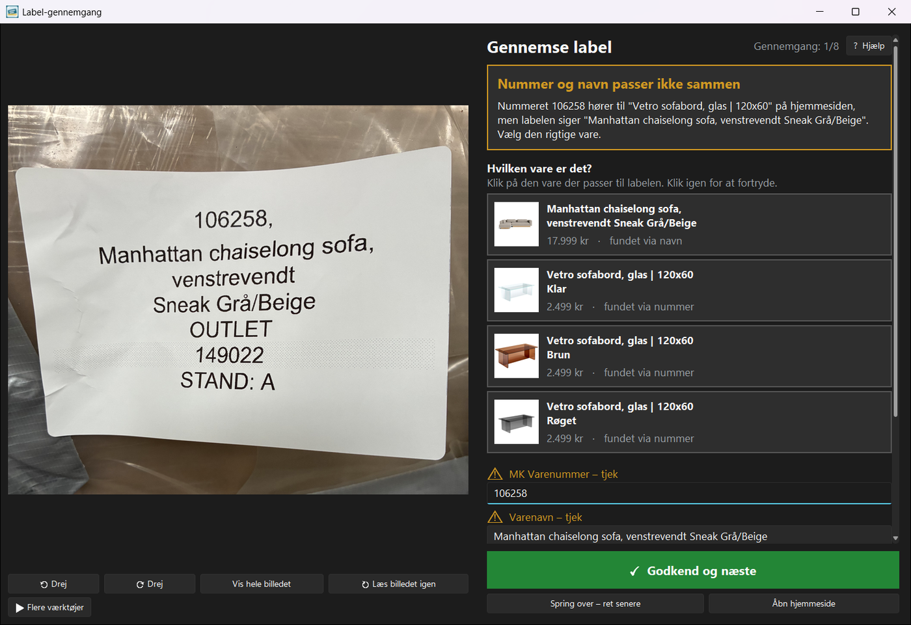
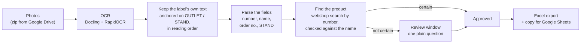
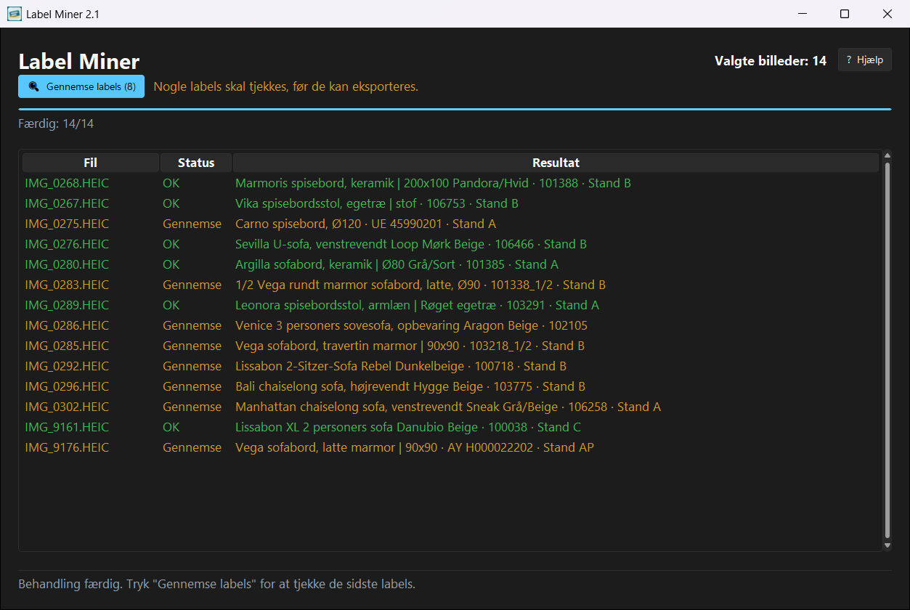

# Label Miner

A Windows desktop app that reads the price labels on photos of furniture, finds each product on the
shop's webshop and exports a spreadsheet: a batch of photos becomes rows ready to paste into the
shop's Google Sheet. It only asks a person about the labels it isn't sure of.



It is the first half of a two-step workflow at a furniture outlet. Label Miner fills the sheet from
photos of incoming items; **Label Printer** (a separate repository) prints the price labels from
that sheet.

## How it works



A label looks like this:

```
106466 - Sevilla U-sofa, venstrevendt
Loop Mørk Beige
OUTLET
142415
STAND: B
```

- **Reading (`ocr.py`).** Each photo is OCR'd once. Photos contain much more than the label
  (shipping labels, box print, other stickers), so only the text blocks centred around the label's
  **OUTLET** and **STAND** lines are kept, ordered by their position on the label. Sideways labels
  are detected from the same geometry and read a second time, turned upright.
- **Parsing (`parsing.py`).** This handles the number formats found on real labels: MK numbers,
  parts of an item (`101338_1/2`) and supplier codes (`UE 45990201`, `VN 19987-330`). It also
  undoes the OCR slips that are safe to undo.
- **Matching (`shop.py`).** A price is only filled in when it is certain: one exact variant, found
  via the label's number, that contains every word of the label's name. A name-only match, or a
  number and name that point to different products, becomes a question instead of a guess.
- **Reviewing (`review.py`, `ui/`).** Each doubtful label gets one plain question in Danish, with
  the webshop's likely products as picture cards. Nothing is saved until the user presses
  "Godkend".



## Results

Measured on 62 real photos against a hand-verified answer key:

| | Version 1.0 | Version 2.x |
|---|---|---|
| Wrong, but approved automatically | 0 | **0** |
| Sent to review | 38 (18 unnecessary) | **20 (all expected)** |
| Correct, approved automatically | 24 | **42** |
| Reviews where the right product wasn't offered | 21 | **0** |

How these numbers were reached is described in [docs/case-study.md](docs/case-study.md). It covers
the answer key, an auto-crop experiment that made things worse and was reverted, and a root-cause
fix in how OCR text is positioned.

## Tests

The tests run the real pipeline without Docling or the internet. OCR results and webshop responses
for the 16 photos in `tests/fixtures/` are **recorded**. The OCR recordings are keyed by the decoded
image pixels, so any change in what the app would send to OCR shows up as a missing recording, not
as a stale result.

- `test_regression.py` scores every fixture photo against the answer key. No label may be approved
  automatically when it is wrong, parts of an item are never priced, and sideways labels are read
  correctly.
- `test_parsing.py` covers the parser and the webshop name matching, using tricky real examples.
- `test_batch.py` covers zip extraction, the export rows and the temp-folder clean-up, which never
  touches a folder another running instance uses.
- `test_ui.py` and `test_app.py` (marked `gui`) test the review window's behaviour, and a whole
  batch driven through the main window from photos to Excel.

`tools/run_label_tests.py` runs the same scoring over a larger, private photo set.

## Getting started

Requires Python 3.10+ on Windows. The pipeline and the tests also run elsewhere.

```powershell
python -m venv .venv
.venv\Scripts\activate
pip install -e .[dev,gui] -c requirements.txt   # enough for the tests
pytest
ruff check . && ruff format --check .

pip install -e .[ocr,gui] -c requirements.txt   # the OCR engine (PyTorch, ~2 GB)
powershell -File packaging\fetch_models.ps1     # optional: models into docling-models\
python -m label_miner                           # start the app (--debug prints what it reads)
```

## Project layout

```
src/label_miner/
  config.py       settings: shop URL, sizes, workers, export columns, colours
  ocr.py          Docling setup, text blocks, picking the label's lines
  parsing.py      the label's fields and warnings (pure functions)
  shop.py         webshop search and the matching rules
  pipeline.py     one photo end to end
  review.py       the question shown for a doubtful label
  batch.py        zip extraction, temp-folder clean-up, export rows
  ui/             Tkinter main window, review window, theme
tests/            pytest suite, replay harness and fixtures
tools/            regression run over a private photo set
docs/manual/      generators for the Danish manual, guides and practice pack
packaging/        PyInstaller spec, Inno Setup installer, build scripts
```

The user interface is in Danish, as the app is used in a Danish shop. Code, comments and docs are
in English.

## Building the installer

```powershell
pip install -r requirements.txt
pip install -e . --no-deps
powershell -File packaging\fetch_models.ps1
winget install --id JRSoftware.InnoSetup -e
powershell -File packaging\build.ps1
```

This builds the manual, freezes the app with PyInstaller (`dist\Label-Miner\`, with the models
bundled so it works offline) and packages it with Inno Setup into
`build\installer\Label-Miner-Setup.exe`. That is a per-user install with no admin rights needed, a
Danish installer, and in-place upgrades.

`docs/manual/` also builds a one-page photo guide, a label guide and a practice pack with an
answer sheet, all from the fixture photos.

## History

The app was built iteratively together with its user. The commit history follows the versions that
were actually used, including the reverted auto-crop experiment (see
[CHANGELOG.md](CHANGELOG.md)). The early versions were a single script, which was later split into
the package above.

## License

[MIT](LICENSE). Third-party licences, including a note on the HEIC libraries, are listed in
[THIRD_PARTY_NOTICES.md](THIRD_PARTY_NOTICES.md).
